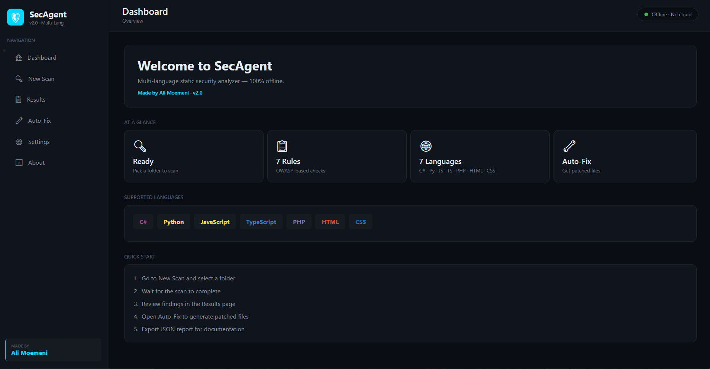
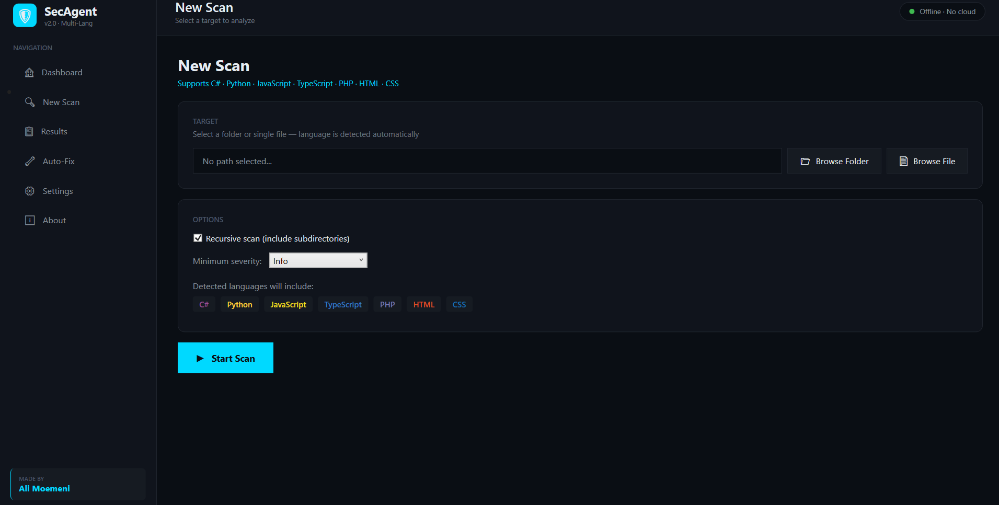
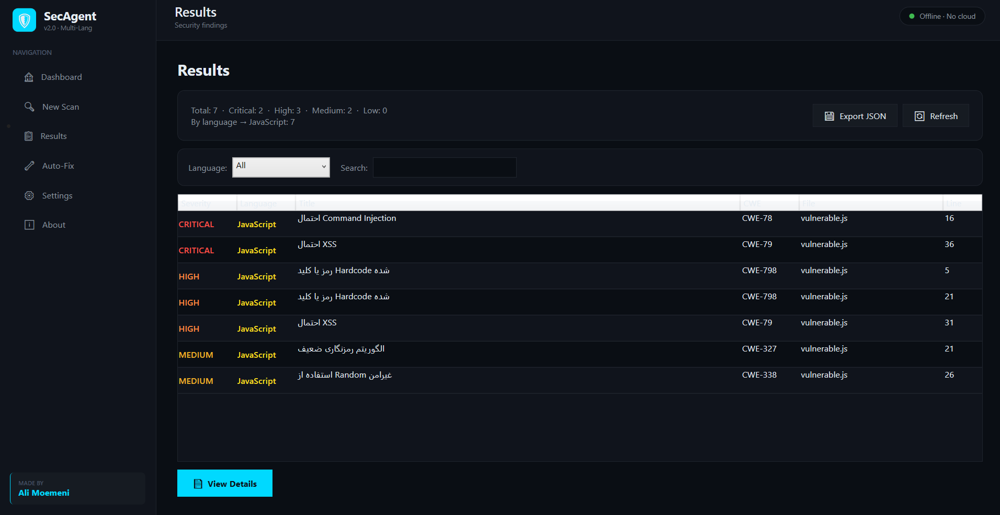
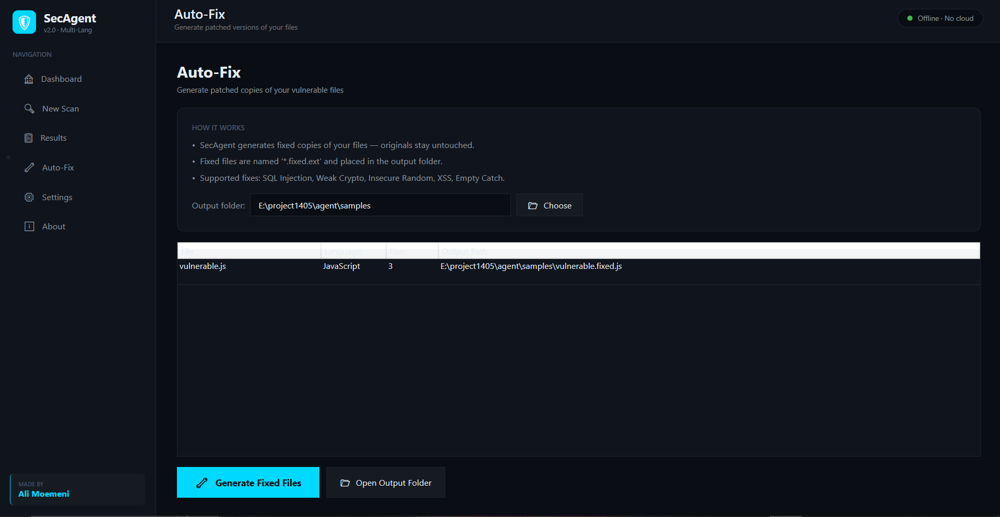

# SecAgent

**A multi-language static security analyzer for developers who care about shipping secure code.**

[Download](#-installation) · [Documentation](docs/) · [Report a Bug](https://github.com/alimoemeni/SecAgent/issues/new?template=bug_report.md) · [Request a Feature](https://github.com/alimoemeni/SecAgent/issues/new?template=feature_request.md)

---

## Why SecAgent?

I spent years watching developers push code they *knew* might have issues — not because they didn't care, but because the existing tools were either too expensive, too complicated to set up, or wanted to upload their source code to someone else's cloud.

SecAgent is my answer to that. It's a **desktop application** that runs entirely on your machine, scans your source code for common security flaws, and — this is the part most tools don't do — **generates fixed versions of your files** so you're not just told about the problem, you get a head start on solving it.

No servers. No accounts. No telemetry. No code leaving your computer. Ever.

---

## What It Does

SecAgent reads your source files, applies a set of security rules, and reports findings with severity, CWE reference, exact file location, and a code snippet. Then, for the vulnerabilities it can handle, it produces a patched copy of the file.

It currently supports **seven languages** and **seven security rules** — carefully chosen to cover the issues that show up most often in real codebases.

<table>
<tr>
<td valign="top" width="50%">

### Supported Languages

- 🟣 **C#** — `.cs`
- 🟡 **Python** — `.py`
- 🟨 **JavaScript** — `.js`, `.mjs`, `.cjs`
- 🔵 **TypeScript** — `.ts`
- 🟪 **PHP** — `.php`, `.phtml`
- 🟠 **HTML** — `.html`, `.htm`
- 🔷 **CSS** — `.css`

</td>
<td valign="top" width="50%">

### Security Rules

| Rule | CWE |
|------|-----|
| SQL Injection | [CWE-89](https://cwe.mitre.org/data/definitions/89.html) |
| Command Injection | [CWE-78](https://cwe.mitre.org/data/definitions/78.html) |
| Cross-Site Scripting | [CWE-79](https://cwe.mitre.org/data/definitions/79.html) |
| Hardcoded Secrets | [CWE-798](https://cwe.mitre.org/data/definitions/798.html) |
| Weak Cryptography | [CWE-327](https://cwe.mitre.org/data/definitions/327.html) |
| Insecure Randomness | [CWE-338](https://cwe.mitre.org/data/definitions/338.html) |
| Empty Catch Blocks | [CWE-390](https://cwe.mitre.org/data/definitions/390.html) |

</td>
</tr>
</table>

---

## Screenshots

### Dashboard

### Scanning a project

### Results with filtering

### Auto-Fix — patched files

> 📸 *Screenshots coming soon. Place them in `docs/screenshots/` to render.*

---

## Installation

### Option 1 — Download the executable (recommended)

1. Head to the [Releases page](https://github.com/alimoemeni/SecAgent/releases)
2. Download the latest `SecAgent-vX.X.X-win-x64.zip`
3. Extract the archive anywhere you like
4. Double-click `SecAgent.exe`

That's it. **No .NET runtime, no installer, no admin rights needed.** The executable bundles everything it needs.

> If Windows SmartScreen warns you about an unknown publisher, click **More info** → **Run anyway**. This happens for any new executable without an expensive code-signing certificate.

